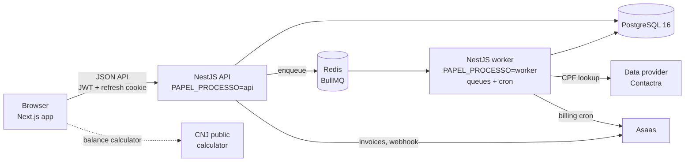

# LA Miner

**B2B prospecting SaaS that mines Brazilian court data for qualified leads.**

[Leia em português](README.pt-BR.md)

LA Miner turns public court data about government debts into a lead pipeline
for law firms. It imports court spreadsheets, identifies each creditor by
their CPF (the Brazilian taxpayer ID), enriches the contact details through a
paid data provider, and delivers a monthly batch of qualified cases to each
subscribing firm, which then works them in a built-in CRM.

**Status:** in production at [app.laminer.com.br](https://app.laminer.com.br).
This repository is a public snapshot of the production codebase. The name of
the contracted data provider was replaced by a placeholder (**Contactra**), and
test fixtures that came from real records were replaced by synthetic data.

---

## The problem, for readers outside Brazil

When the Brazilian government loses a lawsuit and owes money, the debt is paid
through a **precatório**: a court-issued payment order that goes into the public
budget and can take years to be paid. Courts publish lists of these orders.
Many creditors are individuals who may want legal help to follow the case or
to negotiate the credit — so for a law firm each creditor is a potential
client, if the firm can find out who they are and how to reach them.

The data is public but scattered: one spreadsheet per court, each with its own
columns, creditor names next to CPF numbers, and no contact details at all.
LA Miner does that consolidation and enrichment once, in one place, and sells
access to the result by subscription.

### Glossary

| Term | Meaning |
|---|---|
| **CNJ** | *Conselho Nacional de Justiça*, Brazil's National Council of Justice. It defines the unified case number used by every court, `NNNNNNN-DD.AAAA.J.TR.OOOO`, where `J` is the branch of the judiciary and `TR` the court. The importer reads those two segments to reject a file uploaded to the wrong federal court. |
| **TRF** | *Tribunal Regional Federal* — federal regional courts (TRF1 to TRF6). They issue precatórios owed by the federal government. |
| **TJ** | *Tribunal de Justiça* — the state courts (one per state, plus the Federal District's TJDFT). |
| **TRT** | *Tribunal Regional do Trabalho* — regional labor courts. |
| **Precatório** | Court-ordered payment of a government debt, included in the public budget. |
| **Pré-precatório** | A case in the stages *before* the precatório is issued (final judgment, approved calculation, payment request). Riskier, earlier in the funnel. |
| **CPF** | Individual taxpayer ID (11 digits, two check digits). The key that deduplicates creditors across courts. |
| **LGPD** | *Lei Geral de Proteção de Dados*, Brazil's data protection law (similar to the GDPR). Article 18 lists the data subject's rights. |

## Features

- **Spreadsheet import.** CSV/XLSX upload, processed in a queue. Each court's
  layout is described by an *import profile* stored in the database (column
  aliases, required columns, which sheet to read), so a new layout is a data
  change, not a deploy. Re-importing the same file is a no-op: the importer
  compares field by field, records each change in the case timeline, and an
  empty cell never erases existing data.
- **Court catalog.** The database ships with 56 courts — 6 TRFs, 26 TJs and
  24 TRTs — created by the migrations. Import profiles exist for the
  *Dívida Consolidada* lists of TRF1 to TRF6 and for one multi-court
  pre-precatório spreadsheet, where the court comes from a column on each row.
  The catalog is **not** coverage: a court only has leads once data for it is
  imported.
- **Contact enrichment.** Each new creditor is looked up by CPF in a paid data
  provider (Contactra in this repository) through a background queue, with a
  daily spending cap, per-lookup cost tracking and idempotency so the same
  person is never paid for twice on the same day. The provider's name is
  compared with the name on the court record, and mismatches are kept out of
  distribution.
- **Subscriptions and monthly distribution.** Plans define how many new cases a
  firm receives per cycle, the price and the number of seats. On each renewal a
  lottery picks cases the firm has not received before (cases are not
  exclusive between firms), from an explicit allow-list of case phases.
  Billing runs through Asaas (PIX or *boleto*) or in manual mode, with overdue
  handling and suspension after a grace period.
- **CRM for the subscriber.** A page per case with parties, timeline, notes,
  tasks, follow-ups, tags, priority and owner; a kanban funnel; a "my day" view;
  negotiation proposals with an installment schedule; a balance calculator that
  calls the CNJ's official public calculator from the browser.
- **BI dashboard.** Portfolio indicators focused on *reachability* — how much of
  the portfolio value belongs to creditors that can actually be contacted —
  with a map by state.
- **Search** by CPF, name (fuzzy, trigram-indexed) or case number, with every
  search recorded for auditing.
- **Privacy center (LGPD).** Data subject requests (access, correction,
  deletion, objection, portability, review of automated decisions), an audit
  trail of who looked up whose data, and scheduled retention jobs.

## Tech stack

| Layer | Technology |
|---|---|
| API and worker | NestJS 11, TypeScript (strict), Prisma 5, Zod (environment validation), Pino |
| Database | PostgreSQL 16 (`pg_trgm`), hand-written SQL migrations |
| Queues and cron | BullMQ on Redis 7, `@nestjs/schedule` |
| Web | Next.js 16 (App Router), React 18, Tailwind CSS, TanStack Query, Recharts, dnd-kit |
| Auth | JWT access token + rotating refresh token in an httpOnly cookie, argon2id, TOTP |
| Integrations | Data provider (OAuth2 client credentials), Asaas (billing), Resend (e-mail) |
| Tests | Jest + Supertest (API), Vitest + Testing Library (web) |
| Delivery | GitHub Actions, Render Blueprint (`render.yaml`) |

Monorepo with npm workspaces:

```
apps/api            NestJS API and worker (same build, two entry points)
apps/web            Next.js landing page and dashboard
packages/database   Prisma schema, SQL migrations, seed and maintenance scripts
docker/             Postgres and Redis for local development
docs/MIGRATIONS.md  why and how migrations are written by hand
render.yaml         production infrastructure as code
```

## Architecture



- The API serves HTTP and only **produces** jobs. The worker consumes the
  queues and runs the cron jobs (enrichment sync, monthly distribution,
  billing, retention). The same build runs as either role, chosen by
  `PAPEL_PROCESSO` (`api`, `worker` or `tudo` — both, the default for local
  development).
- Two queues on purpose: `importacao` (one file at a time, because two imports
  would interleave diffs on the same rows) and `enriquecimento` (5 concurrent
  lookups). A 100k-row import cannot starve the paid lookups.
- The web app never talks to the data provider or the payment gateway: it only
  calls this API. Provider credentials exist only in the backend process.
- Two kinds of organization share one database: the **internal** organization
  owns the lead base and runs imports and enrichment; **client** organizations
  (subscribing firms) only see the cases released to them.

## Engineering highlights

Decisions that are visible in the code, with the reasoning written next to them.

**Paid calls are guarded like money, because they are.**
- The provider sits behind a port (`EnrichmentProvider`) and is chosen by
  configuration. The fake provider used in development refuses to start with
  `NODE_ENV=production` — twice: in the environment validation and again when
  the module is built.
- A daily cap (`CONTACTRA_TETO_DIARIO`) turns into an unrecoverable job error
  instead of a silent bill; `SYNC_DRY_RUN` defaults to `true`; the processor
  checks whether the person was already *charged* today (a "no data" answer is
  billed too) before calling again.
- The mapper **discards** provider values that don't fit the column (phone,
  area code, state, postal code) instead of truncating them: a truncated phone
  number is a wrong number, and a value that overflows the column would fail
  the transaction *after* the lookup was paid, causing a paid retry.

**Personal data stays where deletion can reach it.**
- Queue jobs carry only the person's UUID, never the CPF — Redis keys and
  payloads would otherwise hold CPFs outside the database, beyond the reach of
  an LGPD deletion. The code explains why a hash of the CPF would not be enough
  (the CPF space is small enough to enumerate).
- The case timeline is append-only and accepts only non-personal fields; the
  allow-list is checked when the module loads, so the API refuses to start if
  someone adds a personal field to it. Monetary values are recorded as "changed",
  never with the amount.
- Logs are structured (Pino) and redact credentials, passwords, CPF, IP
  addresses and user agents. Scheduled jobs enforce retention: raw provider
  payloads are erased after a configurable period (180 days by default), and
  IPs and user agents in access logs are nulled once the 6-month minimum
  required by Brazilian law has passed.

**Multi-tenant isolation with a second line of defense.**
- Every query on tenant-owned tables goes through a scope helper
  (`escopoProcessos`). On top of it, a Prisma extension — the *scope sentinel*
  — flags any bulk query on a tenant-owned table without an organization
  filter: it **blocks** in the test suite and warns in production. The file
  documents why PostgreSQL row-level security was evaluated and rejected for
  this schema.

**Authentication.**
- argon2id with OWASP parameters, account lockout after 5 failed attempts.
- 15-minute access tokens; refresh tokens rotate on every use, are stored
  hashed, travel only in an httpOnly cookie, and reuse of an old refresh token
  revokes the whole token family (theft detection).
- One active session per user (logging in ends the previous session), because
  plans are sold per seat.
- Optional or mandatory TOTP (policy by role) with secrets encrypted at rest
  using AES-256-GCM and recovery codes. The QR code encoder was written in the
  repo to keep the authentication path free of extra dependencies.

**HTTP hardening.**
- Helmet on the API; on the web app, a Content Security Policy with a
  per-request nonce and `strict-dynamic`, generated in the Next.js middleware.
- Named rate-limit buckets, with a unit test that cross-checks every
  `@Throttle()` against the registered names (a typo once disabled the login
  limit silently). The trusted proxy hop count is an exact number, never
  `true`, so clients cannot forge `X-Forwarded-For`.
- Swagger is available in development and refused by the environment
  validation in production.

**Database.**
- Migrations are hand-written SQL, because Prisma cannot see the trigram (GIN)
  indexes and partial unique indexes and would generate scripts that drop them.
  The rule in [docs/MIGRATIONS.md](docs/MIGRATIONS.md) is that every such object
  gets an integration test that writes directly to the database and expects
  the violation.
- Data migrations are idempotent (`UPDATE … RETURNING` feeding the timeline
  event in the same statement).

**Testing and CI.**
- The integration suite runs against a real PostgreSQL and refuses to start if
  the database name doesn't end in `_test`.
- CI order goes from cheapest to most expensive: install with `npm ci` →
  typecheck → unit tests → integration tests → production dependency audit →
  build → check that the build produced the files the deploy will run → deploy
  hooks, only on push to `main`.
- The dependency audit is a gate with *named, dated exceptions*
  (`scripts/auditoria-producao.js`) instead of a raw `npm audit`, so the gate
  stays meaningful instead of permanently red. Today the exception list is
  empty.

## Running locally

Requirements: **Node.js 22.12+**, **PostgreSQL 16** and **Redis 7**.

```bash
npm ci                    # installs and generates the Prisma client
cp .env.example .env
```

In `.env`, set at least:

- `DATABASE_URL` — your Postgres (the migrations create the `pg_trgm` extension);
- `JWT_ACCESS_SECRET` and `JWT_REFRESH_SECRET` — 32+ characters each. Generate
  with `node -e "console.log(require('crypto').randomBytes(48).toString('base64url'))"`;
- `REDIS_HOST` / `REDIS_PORT` / `REDIS_PASSWORD` if your Redis is not the default.

If you use Docker, `npm run infra:up` starts Postgres 16 and Redis 7 bound to
`127.0.0.1` (it requires `POSTGRES_PASSWORD` and `REDIS_PASSWORD` in `.env`).

Then:

```bash
npm run db:migrate:deploy

# first administrator (there is no default password)
ADMIN_EMAIL=admin@example.com ADMIN_SENHA='choose-a-strong-password' \
  node packages/database/scripts/criar-admin.js

npm run dev -w @miner/api     # API     → http://localhost:3333/api  (Swagger: /api/docs)
npm run dev -w @miner/web     # web app → http://localhost:3000
```

The defaults keep everything local: `ENRICHMENT_PROVIDER=fake` (no paid lookup),
`BILLING_PROVIDER=manual` (no real invoice), e-mail provider `fake`. The
database starts empty; cases enter through the **Importação** screen with a
spreadsheet in one of the layouts described by the import profiles.

## Tests

| Suite | Command | Result |
|---|---|---|
| API unit (Jest) | `npm test -w @miner/api` | 339 tests in 28 suites |
| Web unit (Vitest) | `npm test -w @miner/web` | 252 tests in 19 files |
| API integration (Jest + PostgreSQL) | `npm run test:int:preparar -w @miner/api` then `npm run test:int` | 575 tests in 40 suites |

1,166 tests in total, all passing on this snapshot. The unit suites need no
infrastructure. The integration suite needs a Postgres user with `CREATEDB`;
`test:int:preparar` drops and recreates `<db>_test` and applies all
migrations.

## License

The source code is released under the [MIT License](LICENSE).

The names "LA Miner", "Leão Amorim Miner" and "Leão Amorim", the LLA symbol,
the logos, and the website's marketing and legal texts are **not** covered by
the MIT License — all rights reserved. The license also grants no right to the
production database or to any data served by the hosted service. See
[LICENSE](LICENSE) for the details.
