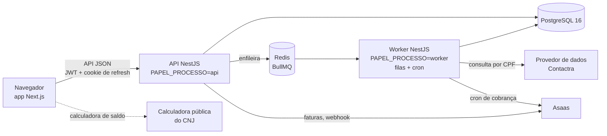

# LA Miner

**SaaS B2B de prospecção que minera dados de tribunais brasileiros e entrega leads qualificados.**

[Read in English](README.md)

O LA Miner transforma dados públicos de tribunais sobre dívidas do poder
público em uma esteira de leads para escritórios de advocacia. Ele importa as
planilhas dos tribunais, identifica cada credor pelo CPF, enriquece os contatos
por meio de um provedor de dados pago e entrega, todo mês, um lote de casos
qualificados a cada escritório assinante, que trabalha esses casos num CRM
embutido.

**Situação:** em produção em [app.laminer.com.br](https://app.laminer.com.br).
Este repositório é uma cópia pública do código de produção. O nome do provedor
de dados contratado foi trocado por um nome fictício (**Contactra**), e as
fixtures de teste que vinham de registros reais foram trocadas por dados
sintéticos.

---

## O problema

Quando o poder público perde uma ação e deve dinheiro, a dívida é paga por
**precatório**: uma ordem de pagamento expedida pelo tribunal, que entra no
orçamento e pode levar anos para ser quitada. Os tribunais publicam listas
desses precatórios. Muitos credores são pessoas físicas que podem querer ajuda
jurídica para acompanhar o caso ou negociar o crédito — então, para um
escritório, cada credor é um cliente em potencial, desde que se descubra quem
ele é e como falar com ele.

O dado é público, mas espalhado: uma planilha por tribunal, cada uma com suas
colunas, nome do credor ao lado do CPF e nenhum contato. O LA Miner faz essa
consolidação e esse enriquecimento uma vez só, num lugar só, e vende o acesso
ao resultado por assinatura.

### Glossário

| Termo | Significado |
|---|---|
| **CNJ** | Conselho Nacional de Justiça. Define a numeração única de processos usada por todos os tribunais, `NNNNNNN-DD.AAAA.J.TR.OOOO`, em que `J` é o segmento do Judiciário e `TR` o tribunal. O importador lê esses dois campos para recusar arquivo enviado ao TRF errado. |
| **TRF** | Tribunal Regional Federal (TRF1 a TRF6). Expede os precatórios devidos pela União. |
| **TJ** | Tribunal de Justiça — os tribunais estaduais (um por estado, mais o TJDFT). |
| **TRT** | Tribunal Regional do Trabalho. |
| **Precatório** | Ordem judicial de pagamento de dívida do poder público, incluída no orçamento. |
| **Pré-precatório** | Processo nas fases *anteriores* à expedição do precatório (trânsito em julgado, cálculos homologados, requisitório expedido). Mais cedo no funil, e mais arriscado. |
| **CPF** | Cadastro de Pessoas Físicas (11 dígitos, dois verificadores). É a chave que deduplica credores entre tribunais. |
| **LGPD** | Lei Geral de Proteção de Dados. O art. 18 lista os direitos do titular. |

## Funcionalidades

- **Importação de planilhas.** Upload de CSV/XLSX, processado em fila. O
  layout de cada tribunal é descrito por um *perfil de importação* guardado no
  banco (apelidos de coluna, colunas obrigatórias, qual aba ler), então layout
  novo é mudança de dado, não deploy. Reimportar o mesmo arquivo não altera
  nada: o importador compara campo a campo, registra cada mudança na linha do
  tempo do processo, e célula vazia nunca apaga o que já existe.
- **Catálogo de tribunais.** O banco nasce com 56 tribunais — 6 TRFs, 26 TJs e
  24 TRTs —, criados pelas migrations. Existem perfis de importação para as
  listas de *Dívida Consolidada* do TRF1 ao TRF6 e um perfil multi-tribunal
  para planilhas de pré-precatórios, em que o tribunal vem de uma coluna em
  cada linha. Catálogo **não** é cobertura: um tribunal só tem leads depois que
  dados dele são importados.
- **Enriquecimento de contatos.** Cada credor novo é consultado por CPF num
  provedor de dados pago (Contactra, neste repositório) por meio de uma fila,
  com teto diário de gasto, registro do custo de cada consulta e idempotência:
  a mesma pessoa nunca é paga duas vezes no mesmo dia. O nome devolvido pelo
  provedor é comparado com o da planilha, e quem diverge fica fora da
  distribuição.
- **Assinaturas e distribuição mensal.** O plano define quantos processos
  novos o escritório recebe por ciclo, o preço e o número de perfis. A cada
  renovação, um sorteio escolhe processos que o escritório ainda não recebeu
  (não há exclusividade entre escritórios), dentro de uma lista explícita de
  fases permitidas. A cobrança roda pelo Asaas (PIX ou boleto) ou em modo
  manual, com inadimplência e suspensão depois de uma carência.
- **CRM do assinante.** Página por processo com partes, linha do tempo,
  anotações, tarefas, follow-ups, etiquetas, prioridade e responsável; funil
  em quadro (kanban); a visão "meu dia"; propostas de negociação com
  cronograma de parcelas; calculadora de saldo que chama, do navegador, a
  calculadora pública oficial do CNJ.
- **BI.** Indicadores de carteira com foco em *alcançabilidade* — quanto do
  valor está com credores que de fato dá para contatar —, com mapa por estado.
- **Busca** por CPF, nome (aproximada, com índice trigram) ou número do
  processo, com cada busca registrada para auditoria.
- **Central de privacidade (LGPD).** Solicitações do titular (acesso, correção,
  exclusão, oposição, portabilidade, revisão de decisão automatizada), trilha
  de quem consultou os dados de quem, e rotinas agendadas de retenção.

## Stack

| Camada | Tecnologia |
|---|---|
| API e worker | NestJS 11, TypeScript (strict), Prisma 5, Zod (validação do ambiente), Pino |
| Banco | PostgreSQL 16 (`pg_trgm`), migrations em SQL escrito à mão |
| Filas e cron | BullMQ sobre Redis 7, `@nestjs/schedule` |
| Web | Next.js 16 (App Router), React 18, Tailwind CSS, TanStack Query, Recharts, dnd-kit |
| Autenticação | JWT de acesso + refresh rotativo em cookie httpOnly, argon2id, TOTP |
| Integrações | Provedor de dados (OAuth2 client credentials), Asaas (cobrança), Resend (e-mail) |
| Testes | Jest + Supertest (API), Vitest + Testing Library (web) |
| Entrega | GitHub Actions, Blueprint da Render (`render.yaml`) |

Monorepo com npm workspaces:

```
apps/api            API e worker NestJS (mesmo build, dois pontos de entrada)
apps/web            landing page e painel em Next.js
packages/database   schema Prisma, migrations SQL, seed e scripts de manutenção
docker/             Postgres e Redis para desenvolvimento
docs/MIGRATIONS.md  por que e como as migrations são escritas à mão
render.yaml         infraestrutura de produção como código
```

## Arquitetura



- A API serve HTTP e só **produz** jobs. O worker consome as filas e roda os
  crons (sincronização do enriquecimento, distribuição mensal, cobrança,
  retenção). O mesmo build roda nos dois papéis, escolhidos por
  `PAPEL_PROCESSO` (`api`, `worker` ou `tudo` — os dois juntos, o padrão em
  desenvolvimento).
- Duas filas, de propósito: `importacao` (um arquivo por vez, porque duas
  importações intercalariam diffs nas mesmas linhas) e `enriquecimento` (5
  consultas em paralelo). Uma importação de 100 mil linhas não estrangula as
  consultas pagas.
- O front nunca fala com o provedor de dados nem com o gateway de pagamento:
  só chama esta API. A credencial do provedor existe só no processo do backend.
- Dois tipos de organização dividem o mesmo banco: a **interna** é dona da base
  e opera importação e enriquecimento; as **clientes** (escritórios
  assinantes) só enxergam os processos liberados para elas.

## Decisões de engenharia

Decisões que estão no código, com o porquê escrito ao lado.

**Chamada paga é tratada como dinheiro, porque é.**
- O provedor fica atrás de uma porta (`EnrichmentProvider`) e é escolhido por
  configuração. O provedor falso, de desenvolvimento, se recusa a subir com
  `NODE_ENV=production` — duas vezes: na validação do ambiente e de novo na
  montagem do módulo.
- Um teto diário (`CONTACTRA_TETO_DIARIO`) vira erro irrecuperável do job em
  vez de fatura silenciosa; `SYNC_DRY_RUN` nasce `true`; o processor confere se
  a pessoa já foi *cobrada* hoje (resposta "sem dados" também é cobrada) antes
  de consultar de novo.
- O mapper **descarta** o valor do provedor que não cabe na coluna (telefone,
  DDD, UF, CEP) em vez de truncar: telefone cortado é número errado, e valor
  maior que a coluna derrubaria a transação *depois* de a consulta ter sido
  paga, provocando uma nova tentativa paga.

**Dado pessoal fica onde a exclusão alcança.**
- O job da fila carrega só o UUID da pessoa, nunca o CPF — senão chaves e
  valores do Redis guardariam CPFs fora do banco, longe do alcance de um pedido
  de exclusão. O código explica por que um hash do CPF não bastaria (o espaço
  de CPFs é pequeno o bastante para ser enumerado).
- A linha do tempo do processo é só de inclusão e aceita apenas campos não
  pessoais; a lista é conferida na carga do módulo, então a API se recusa a
  subir se alguém incluir um campo pessoal. Valor monetário aparece como
  "alterado", nunca com a quantia.
- Logs estruturados (Pino) com redação de credenciais, senhas, CPF, IP e user
  agent. Rotinas agendadas aplicam a retenção: a resposta crua do provedor é
  apagada depois de um prazo configurável (180 dias por padrão), e IP e user
  agent dos registros de acesso viram nulo passado o mínimo de 6 meses exigido
  pelo Marco Civil.

**Isolamento entre inquilinos com uma segunda linha de defesa.**
- Toda consulta em tabela com dono passa por um utilitário de escopo
  (`escopoProcessos`). Por cima dele, uma extensão do Prisma — o *sentinela de
  escopo* — acusa qualquer consulta em massa sobre tabela com dono sem filtro
  de organização: **bloqueia** na suíte de testes e avisa em produção. O
  arquivo documenta por que o row-level security do PostgreSQL foi avaliado e
  recusado para este schema.

**Autenticação.**
- argon2id com parâmetros da OWASP, bloqueio de conta após 5 tentativas.
- Token de acesso de 15 minutos; o refresh gira a cada uso, é guardado como
  hash, viaja só em cookie httpOnly, e reapresentar um refresh antigo revoga a
  família inteira de tokens (detecção de roubo).
- Uma sessão ativa por usuário (entrar encerra a sessão anterior), porque o
  plano é vendido por perfil.
- TOTP opcional ou obrigatório (política por papel), com o segredo cifrado em
  AES-256-GCM e códigos de recuperação. O gerador de QR code foi escrito no
  próprio repositório para manter o caminho de autenticação sem dependência
  extra.

**Endurecimento HTTP.**
- Helmet na API; no front, Content Security Policy com nonce por requisição e
  `strict-dynamic`, gerada no middleware do Next.js.
- Baldes de rate limit com nome, e um teste de unidade que cruza cada
  `@Throttle()` com os nomes registrados (um erro de digitação já desligou em
  silêncio o limite do login). O número de proxies confiáveis é exato, nunca
  `true`, para o cliente não forjar o `X-Forwarded-For`.
- Swagger disponível em desenvolvimento e recusado pela validação do ambiente
  em produção.

**Banco de dados.**
- As migrations são SQL escrito à mão, porque o Prisma não enxerga os índices
  trigram (GIN) nem os índices únicos parciais e geraria scripts que os
  derrubam. A regra do [docs/MIGRATIONS.md](docs/MIGRATIONS.md) é que todo
  objeto assim ganhe um teste de integração que grava direto no banco
  esperando a violação.
- Migrations de dado são idempotentes (`UPDATE … RETURNING` alimentando o
  evento da linha do tempo no mesmo comando).

**Testes e CI.**
- A suíte de integração roda contra PostgreSQL de verdade e se recusa a
  começar se o nome do banco não terminar em `_test`.
- A CI vai do mais barato ao mais caro: instalação com `npm ci` → tipos →
  testes de unidade → testes de integração → auditoria das dependências de
  produção → build → conferência de que o build gerou os arquivos que o deploy
  vai executar → ganchos de deploy, só em push na `main`.
- A auditoria de dependências é um portão com *exceções nomeadas e datadas*
  (`scripts/auditoria-producao.js`) em vez de um `npm audit` cru, para o portão
  continuar significando algo em vez de ficar vermelho para sempre. Hoje a
  lista de exceções está vazia.

## Como rodar localmente

Requisitos: **Node.js 22.12+**, **PostgreSQL 16** e **Redis 7**.

```bash
npm ci                    # instala e gera o client do Prisma
cp .env.example .env
```

No `.env`, preencha pelo menos:

- `DATABASE_URL` — o seu Postgres (as migrations criam a extensão `pg_trgm`);
- `JWT_ACCESS_SECRET` e `JWT_REFRESH_SECRET` — 32+ caracteres cada. Gere com
  `node -e "console.log(require('crypto').randomBytes(48).toString('base64url'))"`;
- `REDIS_HOST` / `REDIS_PORT` / `REDIS_PASSWORD`, se o seu Redis não for o padrão.

Com Docker, `npm run infra:up` sobe Postgres 16 e Redis 7 presos a `127.0.0.1`
(exige `POSTGRES_PASSWORD` e `REDIS_PASSWORD` no `.env`).

Depois:

```bash
npm run db:migrate:deploy

# primeiro administrador (não existe senha padrão)
ADMIN_EMAIL=admin@example.com ADMIN_SENHA='escolha-uma-senha-forte' \
  node packages/database/scripts/criar-admin.js

npm run dev -w @miner/api     # API → http://localhost:3333/api  (Swagger: /api/docs)
npm run dev -w @miner/web     # web → http://localhost:3000
```

Os padrões deixam tudo local: `ENRICHMENT_PROVIDER=fake` (nenhuma consulta
paga), `BILLING_PROVIDER=manual` (nenhuma fatura real), provedor de e-mail
`fake`. O banco começa vazio; os processos entram pela tela **Importação**, com
uma planilha num dos layouts descritos pelos perfis de importação.

## Testes

| Suíte | Comando | Resultado |
|---|---|---|
| Unidade da API (Jest) | `npm test -w @miner/api` | 339 testes em 28 suítes |
| Unidade do front (Vitest) | `npm test -w @miner/web` | 252 testes em 19 arquivos |
| Integração da API (Jest + PostgreSQL) | `npm run test:int:preparar -w @miner/api` e depois `npm run test:int` | 575 testes em 40 suítes |

São 1.166 testes ao todo, todos passando nesta versão. As suítes de unidade
não precisam de infraestrutura. A de integração precisa de um usuário do
Postgres com `CREATEDB`; o `test:int:preparar` derruba e recria o
`<banco>_test` e aplica todas as migrations.

## Licença

O código-fonte é distribuído sob a [licença MIT](LICENSE).

Os nomes "LA Miner", "Leão Amorim Miner" e "Leão Amorim", o símbolo LLA, os
logotipos e os textos comerciais e jurídicos do site **não** estão cobertos
pela licença MIT — todos os direitos reservados. A licença também não dá
direito algum à base de dados de produção nem aos dados servidos pelo serviço.
Detalhes em [LICENSE](LICENSE).
